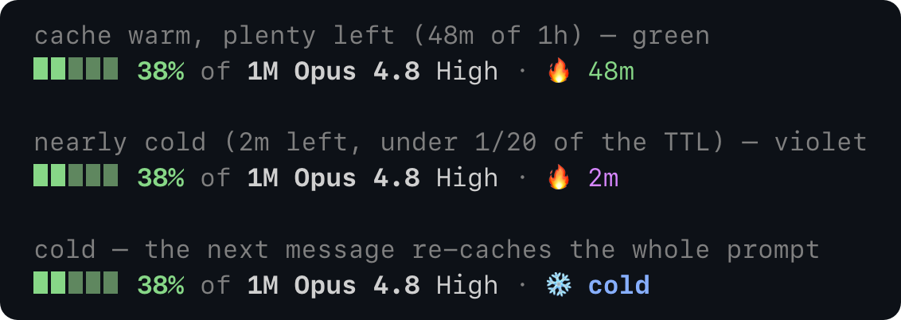
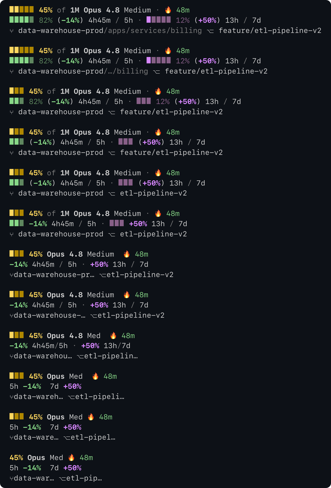
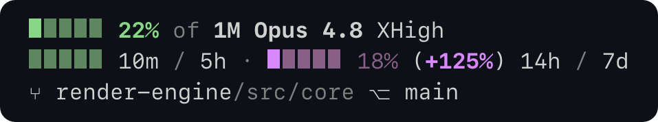
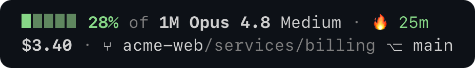
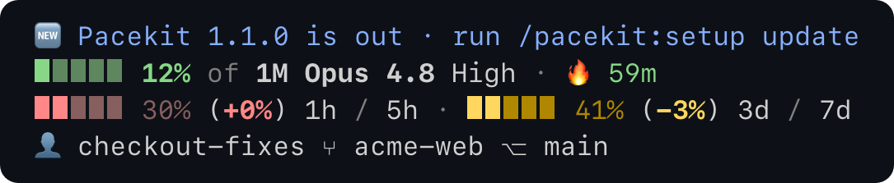
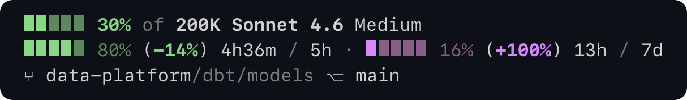
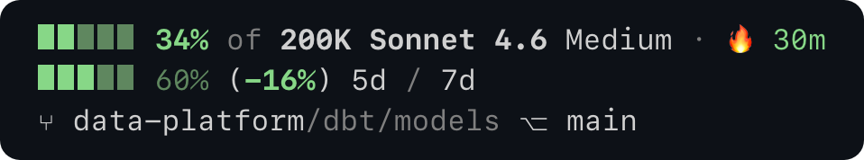
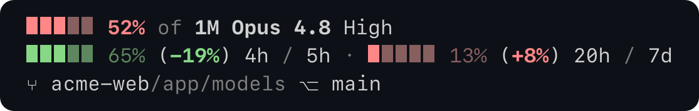
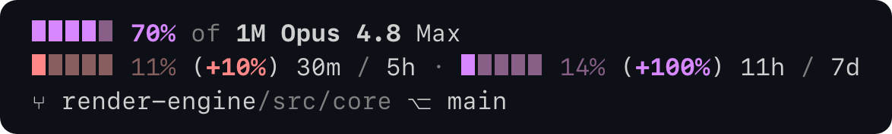

# Pacekit Status Line for Claude Code

Pacekit is a free status line for Claude Code. It tells you, by color, whether you'll run out of your 5-hour or weekly limit before it resets, so you can ease off before you hit the wall. It also shows how full your context is, and how long you can step away before Claude Code's prompt cache expires and your next message costs more.

```sh
curl -fsSL https://raw.githubusercontent.com/jasonericsiegel/pacekit-statusline/main/install.sh | bash
```

It copies one script to `~/.claude/pacekit/` and points Claude Code's status line setting at it ([read it first](install.sh)). Or inside Claude Code: `/plugin install pacekit --marketplace jasonericsiegel/pacekit-statusline`, then `/pacekit:setup`.


## Key features

Each part stays green while things are fine and changes color when it needs you. There's nothing to configure.

### Your pace, not just your usage

Say you're four and a half hours into your 5-hour window, and eleven hours into the week. You've used 72% of your 5-hour limit, but the window is almost over, so the bar is green: at this rate you'll finish under the limit. The weekly bar is only 14% full, yet it's violet: at this rate you'd use up the week in half the time. [Read the colors](#read-the-colors) shows how pace works.

### Room left in the conversation

The context bar turns from green to yellow, red, then violet as it fills, so you know when to wrap up or compact.

### A cache countdown

🔥 48m means the prompt cache stays warm for 48 more minutes. Come back after it goes cold and your next message re-sends the whole conversation, which uses more of your limit. The minutes count down while you're away and change color as the cache runs low. When it goes cold, a blue ❄️ says so, right on time.



### Adapts to any pane width

When a line runs out of room, it drops its least useful details first: bar width, then the fill %, then the clocks. The colored numbers stay down to about 24 columns, so eight panes side by side still tell you what you need.



### Which session is which

The top line is the session's title, and the bottom line names the session, worktree, folder, and branch, so side-by-side sessions don't blur together.

### No stale numbers

When a window resets while you're idle, Pacekit shows it empty, with no pace, until your next message brings a fresh number. You never see a stale number or a made-up 0%.



### Cost on pay-as-you-go

With an API key there are no limit windows, so the session's cost takes their place. On Pro and Max it stays hidden, since there it's only an estimate.



### A notice when there's a new version

Once a day, Pacekit checks GitHub for a newer version. When there is one, line 1 says so until the session's title arrives, with the command that updates it.



## Read the colors

A limit's color is your **pace**, the number in parentheses. Pace compares what you've used with how much of the window has gone by:

```
pace = used% ÷ elapsed% − 1
```

Spend half your 5-hour limit halfway through the window and you're right on pace (`0%`). Spend faster than the clock and pace goes positive: you'll run out before it resets.



| Color | Limit pace | Context | Cache left (on a 1-hour cache) |
|---|---|---|---|
| 🟢 Green | 10% or more under | under 40% | more than 20 minutes |
| 🟡 Yellow | under, by less than 10% | 40–49% | 11 to 20 minutes |
| 🔴 Red | on pace, or up to 10% over | 50–59%, time to wrap up | 4 to 10 minutes |
| 🟣 Violet | more than 10% over | 60% or more, compact or hand off | 3 minutes or less |

On a 5-minute cache the same colors split at the same fractions: a third, a sixth, and a twentieth of the cache's life left.

## More examples

A plan with only a weekly limit shows that window alone:



Mid-session, with context in the red and the two windows disagreeing:



A warning: context nearly full, and both windows barely used but far over pace:



## Before you install

You need Claude Code 2.1.80 or later, bash, and [jq](https://jqlang.org). Git is optional; it adds the branch and worktree.

| Where you use Claude Code | Compatible? |
|---|---|
| A terminal on a Mac | Yes |
| A terminal on Linux, or WSL on Windows | Built for it, and its tests pass with Linux's versions of the command-line tools, but not yet run on a Linux machine. [Tell us](https://github.com/jasonericsiegel/pacekit-statusline/issues/new/choose) if something looks off. |
| Windows, with Git for Windows installed | Built for it, not yet tested. Claude Code runs status lines through Git Bash there. |
| The terminal inside VS Code or JetBrains | Yes, the same as any terminal |
| The Claude desktop app, VS Code's Claude Code panel, or Claude Code on the web | No: they don't show custom status lines. Run `claude` in a terminal instead. |
| Other coding agents, such as Codex or Gemini CLI | No: Pacekit reads what Claude Code sends it, and those can't run a status line script. |

| Your plan | What line 2 shows |
|---|---|
| Pro, Max, or Ultra | Both limit windows, with your pace |
| A plan with only a weekly limit | The weekly window alone |
| Pay-as-you-go API key, Bedrock, or Vertex | The session's cost, with the git details beside it |

Any terminal that shows 256 colors works. In [Ghostty](https://ghostty.org), Pacekit draws its icons with the Nerd Font symbols Ghostty includes, so they take the line's colors.

## Install

1. Open Claude Code.
2. Paste this in:

   > Install the Pacekit status line from https://github.com/jasonericsiegel/pacekit-statusline

3. Send any message. Pacekit appears under the prompt when Claude Code next redraws it.

Claude Code asks before it runs the installer. If jq is missing, it tells you how to install it for your system.

<details>
<summary>Install the plugin</summary>

In Claude Code, run:

```text
/plugin install pacekit --marketplace jasonericsiegel/pacekit-statusline
/pacekit:setup
```

On Claude Code older than 2.1.275, add the marketplace first with `/plugin marketplace add jasonericsiegel/pacekit-statusline`, then run `/plugin install pacekit@pacekit`.

When line 1 says a new version is out, run `/pacekit:setup update`.

</details>

<details>
<summary>Install from a terminal</summary>

```sh
curl -fsSL https://raw.githubusercontent.com/jasonericsiegel/pacekit-statusline/main/install.sh | bash
```

The installer copies `statusline.sh` to `~/.claude/pacekit/` and points the `statusLine` setting in `~/.claude/settings.json` at it, keeping your other settings. If you already had a status line, it saves it, so uninstalling brings it back. Run the same command again to update.

To read the installer before it runs:

```sh
curl -fsSLO https://raw.githubusercontent.com/jasonericsiegel/pacekit-statusline/main/install.sh
less install.sh
bash install.sh
```

Or clone the repository and run `bash install.sh` from it.

</details>

<details>
<summary>Install by hand</summary>

1. Download [statusline.sh](https://raw.githubusercontent.com/jasonericsiegel/pacekit-statusline/main/statusline.sh) to `~/.claude/pacekit/statusline.sh`, then make it runnable: `chmod +x ~/.claude/pacekit/statusline.sh`.
2. Add this to `~/.claude/settings.json`:

   ```json
   {
     "statusLine": {
       "type": "command",
       "command": "~/.claude/pacekit/statusline.sh",
       "refreshInterval": 30
     }
   }
   ```

`refreshInterval` redraws the line every 30 seconds, so the clocks and the cache countdown keep moving while you're idle.

</details>

<details>
<summary>Install on Windows</summary>

1. Install [Git for Windows](https://git-scm.com/download/win), which includes Git Bash, and jq: `winget install jqlang.jq`.
2. Open Git Bash and run the terminal installer above.

Claude Code finds Git Bash on its own and runs status lines through it.

</details>

To remove Pacekit, run `/pacekit:setup uninstall` in Claude Code, or this in a terminal:

```sh
curl -fsSL https://raw.githubusercontent.com/jasonericsiegel/pacekit-statusline/main/install.sh | bash -s -- --uninstall
```

It deletes `~/.claude/pacekit/` and puts back the status line you had before, if any.

## How it compares

Pacekit is one bash script and jq: no Node, no binary, no account, and no config file. It reads what Claude Code hands it, plus one small version check a day.

| What you can do | Pacekit | [ccstatusline](https://github.com/sirmalloc/ccstatusline) | [Claude HUD](https://github.com/jarrodwatts/claude-hud) | [CCometixLine](https://github.com/Haleclipse/CCometixLine) | [claude-pace](https://github.com/Astro-Han/claude-pace) |
|---|---|---|---|---|---|
| See whether you'll run out of a limit before it resets | ✅ | ✅ | Opt-in | ✅ | ✅ |
| Read that from the bar's color, without reading numbers | ✅ | — | Opt-in | — | ✅ |
| See how long you can step away before the cache goes cold | ✅ | ✅ | Expiry time | ✅ | — |
| Keep every line readable in a narrow pane, least useful details dropped first | ✅ | Truncates | Compact layout | Short templates | — |
| See the session's title and name, worktree, and branch | ✅ | ✅ | ✅ | ✅ | Branch |
| Run it without Node or a compiled binary | ✅ | Node or Bun | Node 22.18+ | Binary | ✅ |
| Keep it offline: no network calls of its own | Daily update check | Requests usage from Anthropic's API | ✅ | Daily update check | ✅ |
| Choose themes, colors, and widgets | One fixed design | ✅ | ✅ | ✅ | — |

— means we didn't find it in that tool's documentation, as of November 2026.

## Settings

Pacekit has no config file. A few switches cover the rare cases:

| To | Do this |
|---|---|
| Hide the session title line | Create an empty file at `~/.claude/pacekit-hide-title`. Delete it to bring the line back. |
| Use the emoji icons in Ghostty, or the Nerd Font icons elsewhere | Set `PACEKIT_ICONS=emoji` or `PACEKIT_ICONS=material` |
| Fix lines that end in `…` after a Claude Code update | Set `PACEKIT_MARGIN` to the number of columns Claude Code keeps beside the status line (4 by default) |
| Stop Pacekit leaving usage files for other tools | Set `PACEKIT_STAMPS=off` |
| Turn off the daily check for a new version | Set `PACEKIT_UPDATE_CHECK=off` |

Set a variable by putting it in front of the command in `settings.json`, for example `"command": "PACEKIT_ICONS=emoji ~/.claude/pacekit/statusline.sh"`. Changes show on the next redraw.

<details>
<summary>Usage files for your own tools</summary>

On each redraw Pacekit leaves the latest numbers in two small text files, so a script, a menu bar widget, or a hook can read them without asking Claude Code:

- `/tmp/pacekit-limits`: `<5h used %> <5h reset> <7d used %> <7d reset> <written at>`, as whole numbers and epoch seconds. The limits are account-wide, so there's one file for every session.
- `/tmp/pacekit-ctx-<session id>`: `<context used %> <context size> <written at>`, one per session.

`PACEKIT_LIMITS_FILE` and `PACEKIT_CTX_DIR` move them. `PACEKIT_STAMPS=off` turns both off.

</details>

## Every detail

<details>
<summary>What each part of each line means</summary>

**Line 1, the title.** The session's name from `/rename`, otherwise Claude Code's own title for it. It's cut with `…` to fit, and hidden when there's none or when you turn it off. Until the title arrives, the line shows `🆕` when a newer Pacekit is out.

**Line 2, this conversation.**

| Part | Meaning |
|---|---|
| `▮▮▮▮▮ 45%` | How full the context window is, colored by fullness |
| `of 1M` | The context window's size |
| `Opus 4.8 High` | The model and its effort level, which follows `/effort`. Effort is hidden for models without it. |
| `🔥 48m` or `❄️ cold` | How long the prompt cache stays warm, rounded up so the last minute reads `1m`, never `0m`. It appears after the first reply of a session. |

**Line 3, your limits.** Each window reads `▮▮▮▮▮ 72% (-20%) 4h30m / 5h`: the bar colored by pace, the share used, the pace, how far into the window you are, and which window. Times show whole hours mid-window. Minutes appear in the first hour of either window and in the last hour of the 5-hour one, where they change what you'd do.

**Line 4, where you are.**

| Part | Meaning |
|---|---|
| `👤 checkout-fixes` | The session's name, the one other Claude Code sessions use to message it. A generated name like `myrepo-fd` shows only `fd`, since the folder is already on this line. |
| `⑂ acme-web` | The worktree, or the repository's folder |
| `/services/billing` | The folder you're in inside it |
| `⎇ main` | The branch, hidden when it has the same name as the worktree |

On a pay-as-you-go plan the cost leads the git line instead, and the git details move to a line of their own if they'd otherwise need shortening.

</details>

<details>
<summary>How each line fits a narrow pane</summary>

Claude Code passes the terminal's width with each redraw (version 2.1.153 and later). Pacekit measures every line against it and shortens only the lines that overflow, only as far as they need. Claude Code keeps 4 columns beside the status line, so Pacekit fits each line to the width minus 4.

**Line 2** drops, in order: the `·` before the cache, the word `cold` (the blue ❄️ says it), the window size (`of 1M`), the long effort words (`Medium` becomes `Med`), the model number, the extra space before the 🔥, then the bar. Its bar also shrinks from 5 segments to 3 along with the limit bars. The colored %, the model, the effort, and the cache minutes stay.

**Line 3** drops, in order: bar width (5 segments to 3, the context bar too), the fill %, the parentheses, the window bars, the spaces in `4h45m / 5h`, then the clocks. That leaves `5h -14%  7d +50%`: which window, and whether it's on track.

**Line 4** shortens, in order:

1. Long worktree and branch names, to 24 characters.
2. Outer folders, one at a time: `…/services/billing`, then `…/billing`.
3. The last folder's name, then the folder itself.
4. The branch's prefix: `feature/etl-v2` becomes `etl-v2`.
5. The space after each icon.
6. The worktree and branch names, never below 3 letters.

On a wide terminal, long names show in full.

A resize alone doesn't make Claude Code redraw. The line catches up on the next message or on the next `refreshInterval` tick.

</details>

<details>
<summary>When a window has just reset</summary>

The usage numbers come from your last reply, and the status line can't fetch new ones itself. Limits are account-wide, so after a reset another session may already have used some of the new window. Rather than show a stale number or a misleading 0%, Pacekit draws a reset window as an empty dim bar with its clock and no pace, and fills it in when your next message brings fresh numbers.

When every window shown has reset, the git details move up into their place for that redraw.

</details>

## FAQ

**Does Pacekit make network calls or need a key?**
One, once a day: it reads the latest version number from GitHub, so it can tell you when there's an update. `PACEKIT_UPDATE_CHECK=off` turns it off. Everything else comes from what Claude Code passes it on each redraw, plus Claude Code's own files on your computer for the session's name and whether you're on a subscription. No API key, no account.

**Why is my bar green when it's nearly full?**
Because the color is your pace, not the fill. Most of the window has gone by, so at this rate you'll reach the reset before the limit. See [Read the colors](#read-the-colors).

**Why does a window show an empty bar and no %?**
It reset while you were idle. Its new numbers arrive with your next message.

**Why are my bars thin slivers?**
Your font has no `▮`, so the system borrows one from a font that draws it narrow. In Ghostty, `font-codepoint-map = U+25AE=Apple Symbols` draws it as a fuller block.

**The status line is blank.**
Claude Code hides status lines in folders you haven't trusted yet, and when `disableAllHooks` is on. To see what went wrong, run `claude --debug`, or run the script by hand with sample input:

```sh
echo '{"model":{"display_name":"Opus"},"context_window":{"used_percentage":25}}' | ~/.claude/pacekit/statusline.sh
```

## License

MIT. See [LICENSE](LICENSE).

## Found a problem or have an idea?

[Open an issue](https://github.com/jasonericsiegel/pacekit-statusline/issues/new/choose). Ideas are welcome. Code contributions aren't accepted; see [CONTRIBUTING.md](CONTRIBUTING.md). Changes are listed in [CHANGELOG.md](CHANGELOG.md).

Made by [Jason Eric Siegel](https://www.linkedin.com/in/jasonericsiegel) · [More of my work on GitHub](https://github.com/jasonericsiegel)
